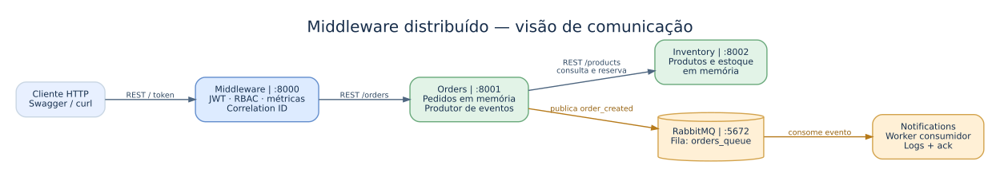

# Middleware Distribuído — Gerenciamento de Pedidos

Projeto acadêmico da disciplina de Sistemas Distribuídos (2º GQ) — Universidade Católica de Pernambuco (UNICAP).

## Objetivo

Demonstrar comunicação **síncrona (REST)** e **assíncrona (RabbitMQ)** entre serviços independentes por meio de um middleware construído com Python e FastAPI, incluindo autenticação, autorização, observabilidade e mecanismos básicos de resiliência.

## Arquitetura

- **Middleware** (`localhost:8000`): porta de entrada; autentica via JWT, aplica papéis e encaminha pedidos ao Orders.
- **Orders** (`localhost:8001`): cria e consulta pedidos; consulta/reserva estoque via HTTP; publica eventos `order_created` no RabbitMQ.
- **Inventory** (`localhost:8002`): catálogo e reserva de produtos, com estoque simulado em memória.
- **RabbitMQ** (`localhost:5672`, painel `localhost:15672`): fila durável `orders_queue`.
- **Notifications** (worker sem API HTTP): consome os eventos, registra uma notificação simulada e confirma a mensagem com `ack`.



Detalhes: [arquitetura](docs/01-arquitetura.md) · [contratos das APIs](docs/02-contratos-api.md) · [consistência e falhas](docs/03-consistencia-e-falhas.md).

## Pré-requisitos

- Docker Engine ou Docker Desktop com Compose disponível.
- Git, caso queira clonar o repositório.
- Portas locais livres: `8000`, `8001`, `8002`, `5672` e `15672`.

## Como executar

```bash
git clone https://github.com/joaomps11/middleware-distribuido-gerenciamento-pedidos.git
cd middleware-distribuido-gerenciamento-pedidos
docker compose up --build
```

O `docker-compose.yml` declara os serviços `middleware`, `orders`, `inventory`, `notifications` e `rabbitmq`, com healthchecks para Orders, Inventory e RabbitMQ. O grupo ainda precisa registrar uma execução completa como evidência para a apresentação.

Verifique a inicialização em outro terminal:

```bash
docker compose ps
docker compose logs -f middleware orders inventory notifications rabbitmq
```

Para encerrar: `docker compose down`.

## Endereços úteis

| Recurso | Endereço |
| --- | --- |
| Middleware / Swagger | http://localhost:8000/docs |
| Middleware / health | http://localhost:8000/health |
| Orders / Swagger (acesso direto para desenvolvimento) | http://localhost:8001/docs |
| Inventory / Swagger (acesso direto para desenvolvimento) | http://localhost:8002/docs |
| RabbitMQ Management | http://localhost:15672 |
| Métricas do Middleware (requer token admin) | http://localhost:8000/metrics |

> Notifications apenas consome eventos da fila, por isso não possui Swagger nem endpoint HTTP. Para testar as permissões, use a porta `8000`, pois o acesso direto às portas `8001` e `8002` não passa pela autenticação do Middleware.

## Como testar o fluxo principal

No terminal com `curl` instalado (em PowerShell, use `curl.exe`):

**1. Solicitar token de demonstração:**

```bash
curl -X POST http://localhost:8000/auth/token \
  -H "Content-Type: application/json" \
  -d '{"username":"admin","password":"admin123"}'
```

A resposta inclui `access_token`. Copie o token recebido e substitua `SEU_TOKEN` nos exemplos.

**2. Criar um pedido:**

```bash
curl -X POST http://localhost:8000/orders \
  -H "Authorization: Bearer SEU_TOKEN" \
  -H "Content-Type: application/json" \
  -d '{"product_id":2,"quantity":1}'
```

**3. Consultar pedidos e métricas (perfil admin):**

```bash
curl -H "Authorization: Bearer SEU_TOKEN" http://localhost:8000/orders
curl -H "Authorization: Bearer SEU_TOKEN" http://localhost:8000/metrics
```

**4. Acompanhar notificações nos logs:**

```bash
docker compose logs -f notifications
```

O estoque de exemplo tem Notebook (`1`), Mouse (`2`) e Teclado (`3`). Como os dados ficam em memória, eles voltam ao estado inicial quando os serviços são reiniciados.

## Segurança e perfis

Há duas contas **exclusivamente de demonstração**, definidas no código: `admin` (papel `admin`) e `cliente` (papel `customer`). Para teste local, o usuário `admin` utiliza a senha de demonstração `admin123`. As credenciais e a chave JWT padrão estão no código/configuração e **não são apropriadas para ambiente de produção**. Não exponha essa configuração na internet.

- `admin`: cria pedidos, lista pedidos, consulta pedido por ID e visualiza métricas.
- `customer`: cria pedidos; consultas administrativas são bloqueadas.

## Observabilidade e resiliência

- Logs com campos JSON (`event`, `correlation_id`, etc.).
- `X-Correlation-ID` é propagado entre chamadas e incluído no evento da fila.
- Métricas em memória de requisições, erros e latência média no Middleware.
- Timeout em chamadas HTTP; tentativas repetidas de publicar eventos no RabbitMQ.

**Limitação atual:** se não for possível enviar o evento ao RabbitMQ, o pedido já criado pode ficar com `notification_status = "pending"`. Não existe reenvio automático desse evento. Além disso, a reserva de estoque e o registro do pedido acontecem em serviços diferentes, sem uma transação que desfaça tudo em caso de falha.

## Tecnologias

Python 3.12 (imagem Docker), FastAPI, Uvicorn, HTTPX, Pika, RabbitMQ, JWT (python-jose), Docker e Docker Compose.
