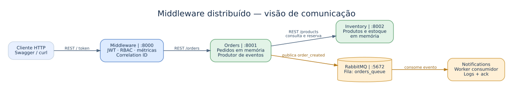

# Arquitetura do Middleware Distribuído

## Componentes

1. **Cliente HTTP** solicita autenticação e operações de pedido ao **Middleware** (porta 8000).
2. **Middleware / FastAPI** gera e valida JWT, verifica papéis, mede requisições e encaminha chamadas relacionadas a pedidos ao **Orders** por REST.
3. **Orders / FastAPI** consulta e reserva produtos no **Inventory** por REST; em seguida mantém o pedido em memória e tenta publicar um evento na fila.
4. **Inventory / FastAPI** mantém catálogo e quantidades em memória.
5. **RabbitMQ** disponibiliza a fila `orders_queue` para receber eventos de novos pedidos.
6. **Notifications**, um processo consumidor Python, processa eventos e escreve logs de notificação simulada; não envia SMS ou e-mail.

## Diagrama

## Fluxo síncrono de um pedido

`Cliente -> Middleware POST /orders -> Orders POST /orders -> Inventory GET /products/{id} -> Inventory POST /products/{id}/reserve -> Orders -> Middleware -> Cliente`.

A comunicação entre processos acontece por HTTP na rede interna criada pelo Docker Compose. Uma falha de conexão ao Inventory é tratada pelo Orders como indisponibilidade (`503`); outros erros HTTP do Inventory podem resultar em `502`.

## Fluxo assíncrono

`Orders -> RabbitMQ (fila orders_queue) -> Notifications`.

O evento contém `event = order_created`, `order_id`, `product`, `quantity`, `total` e `correlation_id`. Orders usa mensagens persistentes (`delivery_mode=2`) e declara fila durável. Notifications confirma o processamento com `basic_ack` ou rejeita mensagens malformadas sem recolocar na fila (`basic_nack` com `requeue=False`). Isso não equivale a garantir publicação de ponta a ponta em todas as falhas possíveis.

## Por que usamos essa estrutura

- **Python e FastAPI:** permitem criar as rotas e testar a comunicação sem complicar a lógica do projeto.
- **Middleware próprio:** reúne autenticação, verificação de papéis, encaminhamento de pedidos e métricas.
- **RabbitMQ:** separa o serviço de pedidos do consumidor de notificações. A publicação ainda ocorre dentro da requisição HTTP, portanto a resposta pode demorar se houver tentativas de reconexão.
- **Docker Compose:** permite iniciar os serviços juntos e configura as dependências e verificações de saúde.
- **Armazenamento em memória:** simplifica a atividade, mas os pedidos e as alterações do estoque se perdem quando os respectivos serviços reiniciam.

## Limitações atuais

- Orders acessa Inventory diretamente pela rede interna; o Middleware é a porta de entrada para pedidos, e não um intermediador obrigatório de cada chamada interna.
- `notification_status = "sent"` significa que Orders concluiu sua chamada de publicação, **não** que Notifications efetivamente processou o evento.
- Sem banco persistente, outbox, compensação transacional nem consumidor idempotente implementado.
- Ao reiniciar o worker Notifications após uma conexão RabbitMQ perdida enquanto já consumia, a reconexão não é tratada por um laço externo no `main()`.

Código disponível em: https://github.com/joaomps11/middleware-distribuido-gerenciamento-pedidos.
