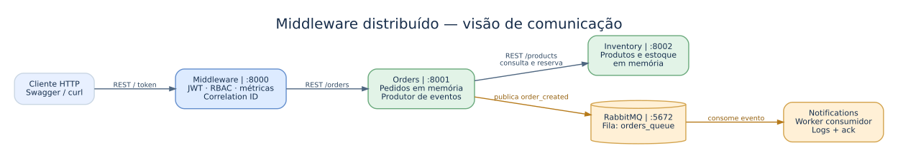

# Relatório técnico — Middleware Distribuído para Gerenciamento de Pedidos

**Universidade Católica de Pernambuco (UNICAP)**  
**Disciplina:** Sistemas Distribuídos — 2º GQ  
**Professor:** Pedro Ximenes  
**Integrantes:** [PREENCHER NOMES E MATRÍCULAS]  
**Versão:** texto-base para revisão do grupo — 19/11/2026

> As informações sobre funcionamento foram conferidas no código do repositório. Os testes de execução e de falhas devem ser preenchidos com resultados reais antes da entrega.

## 1. Objetivo do projeto

Nosso projeto é um sistema simples de gerenciamento de pedidos, dividido em serviços que se comunicam pela rede. A ideia foi usar um domínio fácil de entender para concentrar o trabalho no middleware. Ele recebe as requisições, verifica quem está acessando e encaminha as operações de pedidos. Também usamos uma fila de mensagens para mostrar uma comunicação que não depende de resposta imediata do consumidor.

A implementação foi feita em Python 3.12, com FastAPI para as APIs, HTTPX para chamadas HTTP, Pika e RabbitMQ para mensagens e Docker Compose para executar os componentes separados.

## 2. Arquitetura e decisões

O sistema possui cinco containers: Middleware, Orders, Inventory, Notifications e RabbitMQ. O Middleware funciona como entrada principal do sistema. Quando recebe a criação de um pedido, verifica o token JWT e o papel do usuário e encaminha a chamada ao Orders. Em seguida, Orders consulta o produto e reserva a quantidade solicitada no Inventory por REST.

Depois da reserva, Orders registra o pedido em memória e tenta publicar o evento `order_created` na fila `orders_queue`. O Notifications consome esse evento e registra nos logs uma notificação simulada. Não há envio real de e-mail ou SMS.

Escolhemos REST para consultar e reservar o estoque porque a criação de um pedido precisa saber se o produto está disponível. RabbitMQ foi usado para separar a notificação da lógica do pedido. Já o Docker Compose organiza a inicialização dos serviços e as dependências entre eles.

## 3. Comunicação e segurança

As principais rotas do Middleware são `POST /auth/token`, `POST /orders`, `GET /orders`, `GET /orders/{order_id}` e `GET /metrics`. A autenticação utiliza JWT. O perfil `customer` pode criar pedidos, enquanto o perfil `admin` também consulta pedidos e métricas. Os contratos completos, incluindo corpos e respostas HTTP, estão em `02-contratos-api.md`.

O fluxo de pedidos usa HTTP entre Middleware, Orders e Inventory. Já o envio da notificação passa por RabbitMQ, com Orders como produtor e Notifications como consumidor. O evento contém o identificador do pedido, produto, quantidade, total e um Correlation ID.

Como se trata de um ambiente de demonstração, as contas de teste e a chave JWT estão configuradas no código. Elas precisam ser substituídas ou protegidas caso o sistema seja usado fora do laboratório.

## 4. Observabilidade e resiliência

O projeto registra logs estruturados e usa `X-Correlation-ID` para acompanhar uma requisição entre os serviços. O Middleware também calcula contagem de requisições, erros e latência média; esses valores ficam em memória.

Há timeout configurável no encaminhamento do Middleware para Orders, definido em 60 segundos no Docker Compose, e timeout de cinco segundos por chamada de Orders para Inventory. Na publicação de eventos, Orders tenta se conectar ao RabbitMQ até cinco vezes, com backoff exponencial de 0,5, 1, 2 e 4 segundos entre tentativas. Esses parâmetros podem ser ajustados por variáveis de ambiente.

## 5. Consistência e comportamento em falhas

Os pedidos e o estoque são guardados em memória, sem banco de dados. A reserva acontece antes de Orders registrar o pedido, mas os dois serviços não participam de uma única transação. Portanto, um erro entre essas etapas pode deixar os dados diferentes. Reiniciar Orders apaga os pedidos; reiniciar Inventory recupera o estoque inicial de exemplo.

O processamento de notificações é assíncrono. Por isso, um pedido pode ser criado antes de a notificação ser processada, o que caracteriza consistência eventual nesse fluxo. Existe uma limitação importante: se a publicação falhar nas cinco tentativas, o pedido pode permanecer com `notification_status = "pending"` sem reenvio automático depois.

## 6. Testes, dificuldades e lições

**Situação dos testes:** o código e a configuração do Compose foram analisados, mas os testes de tolerância a falhas ainda não foram executados nesta etapa de documentação. Não estamos tratando resultados previstos como resultados comprovados.

**Testes que precisam ser registrados:** subida dos cinco containers; criação e consulta de pedido; consumo de notificação; conferência do Correlation ID; parada e reinício de Inventory; parada e reinício de RabbitMQ; respostas HTTP, logs e comportamento após reconexão.

**Dificuldades enfrentadas pelo grupo:** [PREENCHER COM SITUAÇÕES REAIS OCORRIDAS DURANTE A IMPLEMENTAÇÃO E OS TESTES].

**O que aprendemos:** [PREENCHER DEPOIS DOS TESTES, EXPLICANDO O QUE AS FALHAS MOSTRARAM SOBRE A COMUNICAÇÃO ENTRE SERVIÇOS].

## 7. Uso de inteligência artificial

Nesta etapa, usamos **ChatGPT (OpenAI, GPT-6)** em 19/11/2026 como apoio para comparar os requisitos do professor com o código do GitHub e organizar os documentos do projeto. Entre os pedidos feitos à ferramenta estavam “do que falta fazer, faz pra mim a metade” e “antes revisa oq foi feito hj e veja se nao ta com muita cara de ia”. A documentação precisa ser revisada pelo grupo, que é responsável por confirmar seu conteúdo.

[ACRESCENTAR AQUI OUTRAS FERRAMENTAS, MODELOS E PROMPTS RELEVANTES UTILIZADOS PELOS INTEGRANTES DURANTE O DESENVOLVIMENTO, SE HOUVER.]

## 8. Referências

- XIMENES, Pedro. *Apresentação do Projeto Middleware Distribuído — 2º GQ*. UNICAP, 22 out. 2026.
- Código-fonte do projeto: https://github.com/joaomps11/middleware-distribuido-gerenciamento-pedidos.
